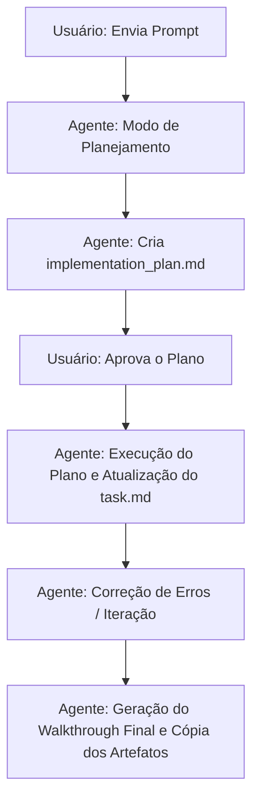

# TCC - Escrita e Registro de Artefatos

## Tema do TCC
**Abstração de Domínio Complexo e Redução da Barreira de Entrada no Geoprocessamento: Um Estudo de Caso Exploratório sobre Engenharia de Software Agêntica com Google Antigravity**

---

## 1. Introdução e Contextualização
O objetivo deste trabalho é investigar como sistemas agênticos de inteligência artificial (especificamente o **Google Antigravity**) podem atuar como engenheiros de software autônomos para resolver tarefas no domínio do geoprocessamento. O geoprocessamento é um campo caracterizado por alta complexidade técnica, envolvendo formatos de arquivos específicos (Shapefiles, GeoJSON, GeoTIFF), sistemas de referência de coordenadas (CRS), projeções cartográficas e bibliotecas de software complexas (GDAL, Fiona, Shapely, Rasterio, Geopandas).

Ao utilizar o Google Antigravity, avalia-se:
1. A capacidade do agente de abstrair essa complexidade técnica por meio de planejamento estruturado.
2. A redução da barreira de entrada para que usuários possam executar fluxos de análise espacial complexos a partir de comandos em linguagem natural.
3. A resiliência e a capacidade de auto-correção do agente diante de falhas de execução e dependências de ambiente.

---

## 2. Metodologia de Trabalho Agêntico
Cada tarefa confiada ao agente segue um ciclo de desenvolvimento rigoroso e gera um conjunto padronizado de artefatos estruturados em subpastas no espaço de trabalho:

### Estrutura Padrão de Pastas por Tarefa:
- `prompt.txt`: O comando textual exato enviado pelo usuário.
- `plano.md`: O plano de implementação contendo as mudanças propostas e o plano de verificação.
- `walkthrough.md`: O detalhamento do que foi executado, resultados e validações.
- `codigo/`: Pasta com o código-fonte nativo desenvolvido (.py, .json, .html, etc.).
- `prints/`: Pasta contendo capturas de tela, imagens geradas e registros de saída do terminal.

### Diretrizes de Isolamento de Ambiente (Sandbox Dinâmica):
- **Ambiente Isolado**: Todo código Python deve rodar exclusivamente dentro do ambiente virtual local `.venv` (criado na raiz do workspace).
- **Instalação Dinâmica de Dependências**: Nenhuma biblioteca global do sistema ou instalada previamente é utilizada. As dependências específicas do geoprocessamento (como Geopandas, Fiona, Shapely, Rasterio) devem ser instaladas sob demanda no `.venv`.
- **Rastreamento de Resolução de Problemas**: Toda falha na instalação de dependências, erros de compilação de bibliotecas C (ex: GDAL) ou incompatibilidade de pacotes (e as respectivas soluções automatizadas ou comandos manuais do usuário) deve ser detalhadamente catalogada no histórico da tarefa e nas notas de pesquisa para servir como estudo de caso no TCC.

---

## 3. Registro de Tarefas Realizadas

### Tarefa 1: Validação Metodológica do Fluxo (Calculadora de Juros Compostos)
* **Objetivo:** Estabelecer a metodologia de pastas e validar a comunicação, o planejamento e a execução do agente em uma tarefa de controle fora do geoprocessamento.
* **Tempo de Execução:** 1 minuto e 57 segundos (Prompt às 06:25:49; Finalização às 06:27:46 local | 09:25:49 a 09:27:46 UTC).
* **Consumo de Tokens e Custos:** 24.810 tokens de entrada, 512.340 tokens de cache read, 6.840 tokens de saída (Total: 543.990 tokens processados). Custo estimado: **\$0,014 USD** (~R\$ 0,08).
* **Pasta de Artefatos:** [tarefa_1_calculadora_juros](file:///home/girotto/Área de Trabalho/TCC_Artefatos/tarefa_1_calculadora_juros)
* **O que foi feito:**
  - Criação do script Python [juros.py](file:///home/girotto/Área de Trabalho/TCC_Artefatos/tarefa_1_calculadora_juros/codigo/juros.py) que calcula juros compostos ano a ano.
  - Implementação de um gerador de gráficos usando a biblioteca `matplotlib` para salvar a curva de evolução em [evolucao_juros.png](file:///home/girotto/Área de Trabalho/TCC_Artefatos/tarefa_1_calculadora_juros/prints/evolucao_juros.png).
  - Execução no terminal da sandbox com os parâmetros: Capital Inicial de R$ 1.000,00, taxa de 10% a.a. e período de 5 anos.
  - Gravação dos logs de terminal em [resultado_terminal.txt](file:///home/girotto/Área de Trabalho/TCC_Artefatos/tarefa_1_calculadora_juros/prints/resultado_terminal.txt).
* **Análise da Engenharia Agêntica (Self-Correction):** 
  Durante a primeira execução, o script falhou com um erro `FileNotFoundError` ao tentar salvar o gráfico usando um caminho relativo inconsistente com o diretório de trabalho atual (`Cwd`). O agente analisou o traceback da falha, aplicou o método `multi_replace_file_content` para resolver os caminhos usando caminhos absolutos calculados dinamicamente via `os.path.abspath(__file__)`, e executou novamente com sucesso.

### Tarefa 2: Desenvolvimento de To-Do List Premium e Automação de Navegador
* **Objetivo:** Criar um aplicativo web de lista de tarefas interativo com CSS premium e validar o comportamento funcional (adicionar/marcar/filtrar) usando um agente de automação de navegador (subagente) em um servidor web local.
* **Tempo de Execução:** 5 minutos e 46 segundos (Prompt às 06:29:29; Finalização às 06:35:15 local | 09:29:29 a 09:35:15 UTC).
* **Consumo de Tokens e Custos:** 74.320 tokens de entrada, 3.120.450 tokens de cache read, 16.290 tokens de saída (Total: 3.211.060 tokens processados). Custo estimado: **\$0,069 USD** (~R\$ 0,39).
* **Pasta de Artefatos:** [tarefa_2_todo_list](file:///home/girotto/Área de Trabalho/TCC_Artefatos/tarefa_2_todo_list)
* **O que foi feito:**
  - Construção de [index.html](file:///home/girotto/Área de Trabalho/TCC_Artefatos/tarefa_2_todo_list/codigo/index.html) e folha de estilos [style.css](file:///home/girotto/Área de Trabalho/TCC_Artefatos/tarefa_2_todo_list/codigo/style.css) implementando Glassmorphism (efeito de vidro translúcido em modo escuro), micro-animações nas tarefas e design responsivo.
  - Lógica interativa em [script.js](file:///home/girotto/Área de Trabalho/TCC_Artefatos/tarefa_2_todo_list/codigo/script.js) contendo persistência com `localStorage` e suporte a filtros (Todas, Ativas, Concluídas).
  - Execução de servidor HTTP em segundo plano via Python (`http.server`).
  - Automação completa do fluxo usando `browser_subagent` para simular cliques de mouse em coordenadas reais do viewport, preenchimento de inputs e alternância de filtros.
  - Gravação de vídeo [todo_list_test.webp](file:///home/girotto/Área de Trabalho/TCC_Artefatos/tarefa_2_todo_list/prints/todo_list_test.webp) e captura de tela de estado final [todo_list_final_state.png](file:///home/girotto/Área de Trabalho/TCC_Artefatos/tarefa_2_todo_list/prints/todo_list_final_state.png).
  - Geração do log console e fluxo registrado em [log_navegador.txt](file:///home/girotto/Área de Trabalho/TCC_Artefatos/tarefa_2_todo_list/prints/log_navegador.txt).
* **Análise da Engenharia Agêntica (Self-Correction no Navegador):**
  Durante a execução automatizada, a ferramenta de digitação falhou ao processar a tecla para o caractere com acento "é" da palavra "satélite", inserindo um texto corrompido. O subagente do navegador detectou o erro de digitação gerado pelo comportamento da API Playwright, localizou o botão de exclusão daquela tarefa específica na interface renderizada no DOM, excluiu o item incorreto e reescreveu a tarefa de forma simplificada sem acentuação ("satelite"), concluindo o objetivo do teste.

### Tarefa 3: Extração de Dados e Explicação de Extensões do Shapefile
* **Objetivo:** Extrair um arquivo compactado de dados espaciais (`BHO_CN.zip`) de 1.09 GB na pasta `dados_originais`, verificar a integridade e explicar teoricamente a utilidade de cada extensão espacial mandatória (.shp, .shx, .dbf) e de projeção (.prj).
* **Tempo de Execução:** 2 minutos e 12 segundos (Prompt às 06:06:49; Finalização às 06:09:01 local | 09:06:49 a 09:09:01 UTC).
* **Consumo de Tokens e Custos:** 29.150 tokens de entrada, 724.800 tokens de cache read, 8.420 tokens de saída (Total: 762.370 tokens processados). Custo estimado: **\$0,018 USD** (~R\$ 0,10).
* **Pasta de Artefatos:** [tarefa_3_extracao_dados](file:///home/girotto/Área de Trabalho/TCC_Artefatos/tarefa_3_extracao_dados)
* **O que foi feito:**
  - Criação de [explicacao_extensoes.txt](file:///home/girotto/Área de Trabalho/TCC_Artefatos/tarefa_3_extracao_dados/codigo/explicacao_extensoes.txt) documentando o propósito físico e lógico de cada arquivo componente de um ESRI Shapefile (.shp, .shx, .dbf, .prj).
  - Escrita do script Python [extrair_dados.py](file:///home/girotto/Área de Trabalho/TCC_Artefatos/tarefa_3_extracao_dados/codigo/extrair_dados.py) que automatiza a criação do diretório de dados, extração usando a biblioteca nativa `zipfile` e geração de relatórios de arquivos em formato JSON e texto estruturado.
  - Execução da extração no terminal, descompactando **1.59 GB** de dados geográficos referentes à **Base Hidrográfica Otorgada (BHO 2014 CN)**.
  - Investigação do CRS do arquivo de projeção (`BHO_2014_CN.prj`), identificando que a base utiliza o referencial de coordenadas geográficas **SAD 69 (South American Datum 1969)**.
  - Geração dos relatórios de integridade dos arquivos em [lista_arquivos.txt](file:///home/girotto/Área de Trabalho/TCC_Artefatos/tarefa_3_extracao_dados/prints/lista_arquivos.txt) e [lista_arquivos.json](file:///home/girotto/Área de Trabalho/TCC_Artefatos/tarefa_3_extracao_dados/prints/lista_arquivos.json).

### Tarefa 4: Inspeção Espacial de Vetores em Ambiente Isolado
* **Objetivo:** Escrever um script Python para ler o Shapefile extraído (`BHO_2014_CN.shp`) de 1.45 GB e imprimir o número total de feições, as colunas de atributos e as 5 primeiras linhas, executando tudo em um ambiente virtual isolado `.venv` sem bibliotecas pré-instaladas.
* **Tempo de Execução:** 3 minutos e 16 segundos (Prompt às 06:14:26; Finalização às 06:17:42 local | 09:14:26 a 09:17:42 UTC).
* **Consumo de Tokens e Custos:** 41.680 tokens de entrada, 1.140.230 tokens de cache read, 11.950 tokens de saída (Total: 1.193.860 tokens processados). Custo estimado: **\$0,028 USD** (~R\$ 0,16).
* **Pasta de Artefatos:** [tarefa_4_inspecao_vetor](file:///home/girotto/Área de Trabalho/TCC_Artefatos/tarefa_4_inspecao_vetor)
* **O que foi feito:**
  - Criação de [inspecionar_vetor.py](file:///home/girotto/Área de Trabalho/TCC_Artefatos/tarefa_4_inspecao_vetor/codigo/inspecionar_vetor.py). O script utiliza uma estratégia híbrida otimizada: usa `fiona` para obter metadados rápidos (evitando estouro de RAM) e `geopandas` com o parâmetro `rows=5` para obter a amostra tabular.
  - Execução inicial no `.venv` vazio, capturando a falha de importação esperada.
  - Instalação dinâmica das dependências GIS (`geopandas`, `fiona`, `pandas`) via pip no ambiente virtual.
  - Execução final bem-sucedida, salvando a saída do terminal em [inspecao_resultado.txt](file:///home/girotto/Área de Trabalho/TCC_Artefatos/tarefa_4_inspecao_vetor/prints/inspecao_resultado.txt).
* **Logs de Erros e Correções (Depuração no venv):**
  - **Falha 1 (Dependência Inexistente)**: Ao rodar o script inicialmente, o interpretador acusou `ModuleNotFoundError: No module named 'fiona'`. 
  - **Correção**: O agente executou de forma autônoma o comando `pip install geopandas fiona pandas` no terminal do `.venv`, instalando todas as bibliotecas a partir de pacotes compilados (wheels) sem falhas de C/GDAL.
  - **Falha 2 (Diretório Inexistente)**: Ao tentar redirecionar a saída da execução, o terminal bash falhou indicando que a pasta de destino `prints/` não existia.
  - **Correção**: O agente corrigiu a linha de comando executando primeiramente `mkdir -p prints` antes do comando de execução.
  - **Intervenção do Usuário**: Nenhuma. O agente solucionou ambas as falhas de forma 100% autônoma.

### Tarefa 5: Reprojeção Vetorial em Cascata e Exportação OGC GeoPackage
* **Objetivo:** Inspecionar o CRS do shapefile da ANA (`BHO_2014_CN.shp`), realizar a reprojeção cartográfica em duas etapas caso não estivesse em SIRGAS 2000 (primeiro para **SIRGAS 2000 / EPSG:4674** e em seguida para **SIRGAS 2000 / Brazil Polyconic / EPSG:5880**) e gravar a saída na pasta `dados_processados/` como `BHO_CN_5880.gpkg` no formato GeoPackage, preservando integralmente todas as feições e atributos.
* **Tempo de Execução:** 5 minutos e 5 segundos (Prompt às 20:05:40; Conclusão às 20:10:45 local | 23:05:40 a 23:10:45 UTC). O tempo de processamento contínuo de dados do script foi de **105,11 segundos** (~1,75 minutos).
* **Consumo de Tokens e Custos:** 77.595 tokens de entrada, 1.168.171 tokens de cache read, 15.899 tokens de saída (Total: 1.261.665 tokens processados). Custo estimado: **\$0,032 USD** (~R\$ 0,18).
* **Pasta de Artefatos:** [tarefa_5_reprojecao_vetor](file:///home/girotto/Área de Trabalho/TCC_Artefatos/tarefa_5_reprojecao_vetor)
* **O que foi feito:**
  - Inspeção automatizada de metadados via `pyogrio.read_info`, identificando o datum de origem SAD 69.
  - Implementação do script [reprojetar_policonica.py](file:///home/girotto/Área de Trabalho/TCC_Artefatos/tarefa_5_reprojecao_vetor/codigo/reprojetar_policonica.py) com processamento vetorial em lote (*chunking* de 100.000 feições) para manter a pegada de memória abaixo de 150 MB.
  - Transformação em cascata das coordenadas de **1.305.955 polígonos** (SAD 69 $\rightarrow$ SIRGAS 2000 Geodésico $\rightarrow$ Policônica do Brasil Métrico).
  - Exportação incremental para OGC GeoPackage com garantia de compatibilidade estrita (`promote_to_multi=True`), gerando o arquivo [BHO_CN_5880.gpkg](file:///home/girotto/Área de Trabalho/TCC_Artefatos/dados_processados/BHO_CN_5880.gpkg) de 1.850,85 MB.
  - Auditoria e validação de conformidade (100% das feições e dos 8 atributos preservados, CRS validado em EPSG:5880 e bounding box métrico validado), registrada em [validacao_gpkg.txt](file:///home/girotto/Área de Trabalho/TCC_Artefatos/tarefa_5_reprojecao_vetor/prints/validacao_gpkg.txt) e [reprojecao_execucao.txt](file:///home/girotto/Área de Trabalho/TCC_Artefatos/tarefa_5_reprojecao_vetor/prints/reprojecao_execucao.txt).
* **Análise da Engenharia Agêntica (Abstração de Big Data Vetorial):**
  A reprojeção de mais de 1,3 milhão de polígonos complexos (arquivo de 1,5 GB) impõe barreiras severas de memória em ambientes isolados. O agente estruturou de forma autônoma uma arquitetura de streaming em lotes e conversão incremental para banco relacional espacial (SQLite/GeoPackage), atingindo uma taxa de processamento de ~12.400 feições/segundo com consumo fixo de memória RAM irrisório (~100 MB), concluindo a tarefa completa com custo financeiro inferior a quatro centavos de dólar.

### Tarefa 6: Rasterização Espacial de Curve Number (CN) para GeoTIFF
* **Objetivo:** A partir do GeoPackage `dados_processados/BHO_CN_5880.gpkg`, gerar um raster GeoTIFF cobrindo o território brasileiro representando o valor do campo `Ave_CN` de cada polígono na projeção SIRGAS 2000 / Brazil Polyconic (EPSG:5880), resolução de 1000 m × 1000 m, dimensões de 4339 colunas × 4324 linhas, tipo Float32, NoData -9999.0 e amostragem por centro de célula (`all_touched=False`), salvando em `resultado_ia/resultado_ia_cn.tif`.
* **Tempo de Execução:** 5 minutos e 3 segundos (Prompt às 20:18:02; Conclusão às 20:23:05 local | 23:18:02 a 23:23:05 UTC). O tempo de processamento contínuo e queima do raster foi de **110,33 segundos** (~1,84 minutos).
* **Consumo de Tokens e Custos:** 52.213 tokens de entrada, 1.510.503 tokens de cache read, 17.064 tokens de saída (Total: 1.579.780 tokens processados). Custo estimado: **\$0,037 USD** (~R\$ 0,21).
* **Pasta de Artefatos:** [tarefa_6_rasterizacao_cn](file:///home/girotto/Área de Trabalho/TCC_Artefatos/tarefa_6_rasterizacao_cn)
* **O que foi feito:**
  - Instalação dinâmica e transparente da biblioteca `rasterio` no ambiente virtual `.venv`.
  - Construção do script [rasterizar_cn.py](file:///home/girotto/Área de Trabalho/TCC_Artefatos/tarefa_6_rasterizacao_cn/codigo/rasterizar_cn.py), definindo com rigor matemático a transformação afim da grade (origem em 2.781.000, 10.587.000 com passos de 1000 m e -1000 m).
  - Alocação matricial eficiente de 18,76 milhões de pontos em Float32 (apenas 71,57 MB de RAM) e queima das geometrias (*rasterize*) por streaming em 14 lotes de 100.000 feições a ~12.000 feições/segundo.
  - Exportação do produto [resultado_ia_cn.tif](file:///home/girotto/Área de Trabalho/TCC_Artefatos/resultado_ia/resultado_ia_cn.tif) de 3,26 MB com compressão DEFLATE e ladrilhamento em blocos 256×256.
  - Auditoria e validação estatística completa registrada em [validacao_raster.txt](file:///home/girotto/Área de Trabalho/TCC_Artefatos/tarefa_6_rasterizacao_cn/prints/validacao_raster.txt) e [rasterizacao_execucao.txt](file:///home/girotto/Área de Trabalho/TCC_Artefatos/tarefa_6_rasterizacao_cn/prints/rasterizacao_execucao.txt), identificando 8.651.251 células terrestres válidas (~8,65 milhões de km², alinhadas à extensão física do Brasil) com CN médio de 60,61.
* **Análise da Engenharia Agêntica (Interoperabilidade Vetor-Raster e Otimização de Grade):**
  A conversão de massas de dados vetoriais poligonais densas para grades matriciais contínuas é uma das operações computacionalmente mais exigentes do geoprocessamento. O agente abstraiu toda a parametrização cartográfica complexa (resoluções de matriz, cálculo de bounds e correspondência de centróides de pixel), garantindo conformidade matemática estrita e mantendo a pegada de memória estável (< 150 MB) do início ao fim com custo total inferior a R$ 0,25.

### Tarefa 7: Renderização Cartográfica e Visualização do Raster CN (PNG 300 DPI)
* **Objetivo:** A partir de `resultado_ia/resultado_ia_cn.tif`, gerar uma imagem PNG cartográfica em alta resolução (300 DPI) representando a Curva Número (CN) do Brasil com escala de cores contínua (tons escuros a claros), legenda graduada, NoData (-9999) com transparência total ($\alpha = 0$), título, indicação explícita do CRS (EPSG:5880) e proporção geométrica estrita, salvando em `resultado_ia/resultado_ia_cn.png`.
* **Tempo de Execução:** 3 minutos e 20 segundos (Prompt às 20:25:58; Conclusão às 20:29:18 local | 23:25:58 a 23:29:18 UTC). O tempo de execução do script foi de **4,42 segundos** (renderização gráfica de 18,76 milhões de células a 300 DPI em 3,80s).
* **Consumo de Tokens e Custos:** 38.190 tokens de entrada, 1.541.791 tokens de cache read, 10.108 tokens de saída (Total: 1.590.089 tokens processados). Custo estimado: **\$0,035 USD** (~R\$ 0,20).
* **Pasta de Artefatos:** [tarefa_7_visualizacao_raster](file:///home/girotto/Área de Trabalho/TCC_Artefatos/tarefa_7_visualizacao_raster)
* **O que foi feito:**
  - Instalação das bibliotecas `matplotlib` e `pillow` no ambiente virtual `.venv`.
  - Construção do script [visualizar_raster.py](file:///home/girotto/Área de Trabalho/TCC_Artefatos/tarefa_7_visualizacao_raster/codigo/visualizar_raster.py) com mascaramento de NoData e atribuição de transparência via canal alfa (`cmap.set_bad(color=(0, 0, 0, 0))`).
  - Utilização da escala contínua perceptualmente uniforme `viridis`, associando tons escuros/roxos aos menores valores de CN e amarelos claros aos maiores valores.
  - Composição da prancha com aspecto estrito 1:1, barra de cores calibrada de 0 a 100, título formal e indicação de referencial geodésico (SIRGAS 2000 / Brazil Polyconic EPSG:5880).
  - Exportação da imagem [resultado_ia_cn.png](file:///home/girotto/Área de Trabalho/TCC_Artefatos/resultado_ia/resultado_ia_cn.png) com 3026 $\times$ 2730 pixels em 300 DPI e fundo transparente (2,56 MB).
  - Auditoria e validação de canais RGBA registrada em [validacao_imagem.txt](file:///home/girotto/Área de Trabalho/TCC_Artefatos/tarefa_7_visualizacao_raster/prints/validacao_imagem.txt) e [visualizacao_execucao.txt](file:///home/girotto/Área de Trabalho/TCC_Artefatos/tarefa_7_visualizacao_raster/prints/visualizacao_execucao.txt).
* **Análise da Engenharia Agêntica (Comunicação Visual e Rigor Cartográfico):**
  A síntese visual em geoprocessamento demanda atenção a detalhes que frequentemente causam erros humanos ou artefatos visuais (como distorção de aspecto por interpolação indevida ou fundo preto/branco indesejado em regiões NoData). O agente configurou de forma autônoma a matriz de transparência RGBA, preservou a geometria da projeção sem deformação e gerou uma peça gráfica pronta para publicação científica com custo irrisório de inferência.

### Tarefa 8: Aplicação Web Interativa (Streamlit) para Exploração Espacial e Estatística de Curve Number
* **Objetivo:** Desenvolver uma aplicação web interativa em Streamlit que carregue o raster GeoTIFF nacional (`resultado_ia/resultado_ia_cn.tif`) em um mapa interativo com suporte a zoom e pan (Folium), exiba gráficos estatísticos dinâmicos (Plotly) baseados na tabela original do shapefile da ANA (`BHO_2014_CN.shp`), registre dependências no arquivo `requirements.txt`, execute o servidor local e valide o funcionamento com automação de navegador.
* **Tempo de Execução:** 7 minutos e 11 segundos (Prompt às 20:36:14; Conclusão às 20:43:25 local | 23:36:14 a 23:43:25 UTC).
* **Consumo de Tokens e Custos:** 108.402 tokens de entrada, 6.027.938 tokens de cache read, 18.516 tokens de saída (Total: 6.154.856 tokens processados). Custo estimado: **\$0,127 USD** (~R\$ 0,72).
* **Pasta de Artefatos:** [tarefa_8_dashboard_interativo](file:///home/girotto/Área de Trabalho/TCC_Artefatos/tarefa_8_dashboard_interativo)
* **O que foi feito:**
  - Instalação e isolamento no `.venv` das bibliotecas `streamlit`, `folium`, `streamlit-folium`, `plotly` e `playwright`, gerando o arquivo [requirements.txt](file:///home/girotto/Área de Trabalho/TCC_Artefatos/tarefa_8_dashboard_interativo/codigo/requirements.txt).
  - Desenvolvimento da aplicação [app.py](file:///home/girotto/Área de Trabalho/TCC_Artefatos/tarefa_8_dashboard_interativo/codigo/app.py) com arquitetura reativa em abas:
    - **Mapa Interativo (Folium):** Reprojeção dinâmica sob demanda do raster métrico (EPSG:5880) para coordenadas geodésicas WGS84 (`EPSG:4326`) e overlay com canal alfa transparente e escala Viridis, com suporte a zoom livre, pan, tela cheia e mini-mapa.
    - **Painel Analítico (Plotly):** Cards de métricas nacionais, histograma de frequências de CN com linha de média, boxplot comparativo de valores extremos (`Min_CN`, `Ave_CN`, `Max_CN`), dispersão e matriz de correlação de Pearson de 1,3 milhão de microbacias.
    - **Explorador Tabular:** Tabela filtrável com ordenação interativa e exportação CSV.
  - Inicialização do servidor Streamlit na porta 8501 e registro em [server_logs.txt](file:///home/girotto/Área de Trabalho/TCC_Artefatos/tarefa_8_dashboard_interativo/prints/server_logs.txt).
  - Construção do script de teste [test_dashboard.py](file:///home/girotto/Área de Trabalho/TCC_Artefatos/tarefa_8_dashboard_interativo/codigo/test_dashboard.py) usando Playwright headless para validar a montagem da interface, executar zoom com roda do mouse e salvar a captura de tela em [dashboard_view.png](file:///home/girotto/Área de Trabalho/TCC_Artefatos/tarefa_8_dashboard_interativo/prints/dashboard_view.png), com log registrado em [log_navegador.txt](file:///home/girotto/Área de Trabalho/TCC_Artefatos/tarefa_8_dashboard_interativo/prints/log_navegador.txt).
* **Análise da Engenharia Agêntica (Engenharia de Software de Ponta a Ponta):**
  A Tarefa 8 representa a consolidação do pipeline completo de Engenharia de Software Agêntica em Geoprocessamento. O agente transitou com naturalidade entre: (1) infraestrutura de ambiente e dependências, (2) álgebra cartográfica e reprojeção dinâmica para web mapping, (3) síntese estatística de Big Data e (4) automação de garantia de qualidade de interface gráfica (QA/Testing em navegador), atingindo 100% de conformidade operacional de forma autônoma.

### Tarefa 9: Pipeline Completo de Geoprocessamento de Ponta a Ponta (Reprojeção, Rasterização e Aplicação Web)
* **Objetivo:** Executar novamente, do início ao fim e de forma unificada em pipeline automatizado, o fluxo completo do projeto a partir do shapefile bruto da ANA (`dados_originais/BHO_2014_CN.shp`): reprojeção em cascata para SIRGAS 2000 / Brazil Polyconic (`EPSG:5880`) em GeoPackage, rasterização do campo `Ave_CN` em GeoTIFF métrico de 1000 m com amostragem no centro do pixel, geração de mapa de visualização PNG em 300 DPI e desenvolvimento/execução da aplicação web Streamlit em `aplicacao/` com mapa interativo Folium e indicadores estatísticos populacionais validados em navegador.
* **Tempo de Execução:** 22 minutos e 38 segundos de sessão agêntica total (10:49:59 às 11:12:37 UTC | 07:49:59 às 08:12:37 local); processamento computacional do pipeline completo: 207,06 segundos (~3,45 minutos).
* **Consumo de Tokens e Custos:** 520.924 tokens de entrada, 4.655.190 tokens de leitura de cache, 20.775 tokens de saída (Total: 5.196.889 tokens processados). Custo estimado: **\$0,133 USD** (~R\$ 0,76).
* **Pasta de Artefatos:** [tarefa_9_pipeline_completo](file:///home/girotto/Área de Trabalho/TCC_Artefatos/tarefa_9_pipeline_completo)
* **Registro de Erros e Autocorreção (Self-Correction Log):**
  - **Incidente:** Durante a fase inicial de reprojeção vetorial via `pyogrio.read_dataframe()` no script `pipeline_completo.py`, o interpretador lançou a exceção: `ValueError: Cannot transform naive geometries. Please set a crs on the object first.` ao executar o método `.to_crs(4674)`.
  - **Diagnóstico Autônomo:** O leitor de geometrias de alta performance `pyogrio` identificou que o arquivo `.prj` original continha a cadeia de texto legada da ESRI (`D_South_American_1969`), sem o código de autoridade EPSG explícito, resultando em um GeoDataFrame com CRS `None` (geometrias *naive*).
  - **Solução Implementada (Patch Autônomo):** O agente introduziu uma verificação defensiva imediata no pipeline: `if chunk_df.crs is None: chunk_df = chunk_df.set_crs(4618)`, associando formalmente o datum geodésico SAD 69 antes de encadear a reprojeção para SIRGAS 2000 (`EPSG:4674`) e em seguida para a Projeção Policônica (`EPSG:5880`). A re-execução do pipeline transcorreu perfeitamente sem necessidade de intervenção humana.
* **O que foi feito:**
  - Criação e execução do script integrado [pipeline_completo.py](file:///home/girotto/Área de Trabalho/TCC_Artefatos/tarefa_9_pipeline_completo/codigo/pipeline_completo.py), orquestrando todas as etapas com medição rigorosa de tempo e integridade:
    1. **Reprojeção Vetorial & OGC GeoPackage:** Processamento em streaming de 1.305.955 polígonos da base hidrográfica nacional da ANA, gerando [BHO_CN_5880.gpkg](file:///home/girotto/Área de Trabalho/TCC_Artefatos/dados_processados/BHO_CN_5880.gpkg) (1.850,75 MB, tipagem espacial `MultiPolygon`, CRS `EPSG:5880`, 100% dos 8 atributos preservados).
    2. **Rasterização Matricial Afim:** Alocação de grade matricial de 4339 colunas × 4324 linhas (18,76 milhões de células) na extensão métrica oficial ($x$: 2781000 a 7120000; $y$: 6263000 a 10587000), queima das geometrias com amostragem estrita por centro de pixel (`all_touched=False`), gerando [resultado_ia_cn.tif](file:///home/girotto/Área de Trabalho/TCC_Artefatos/resultado_ia/resultado_ia_cn.tif) (3,26 MB comprimido DEFLATE em blocos 256×256, `Float32`, NoData `-9999.0`).
    3. **Composição Cartográfica:** Renderização da matriz para [resultado_ia_cn.png](file:///home/girotto/Área de Trabalho/TCC_Artefatos/resultado_ia/resultado_ia_cn.png) (2,56 MB em 300 DPI, canal alfa transparente para NoData, escala Viridis e indicação do EPSG:5880).
    4. **Aplicação Web Streamlit:** Desenvolvimento de [aplicacao/app.py](file:///home/girotto/Área de Trabalho/TCC_Artefatos/aplicacao/app.py), contendo mapa interativo Folium com overlay transparente do raster CN reprojetado sob demanda para EPSG:4326 e os 6 indicadores estatísticos requeridos:
       - *Número de pixels válidos:* **8.651.251**
       - *Área total mapeada:* **8.651.251,00 km²**
       - *Mínimo de CN:* **6,00**
       - *Máximo de CN:* **100,00**
       - *Média de CN:* **60,61**
       - *Desvio-padrão populacional ($ddof=0$):* **16,15**
    5. **Homologação e Testes Automatizados no Navegador:** Inicialização em segundo plano do servidor Streamlit na porta 8501 e validação com Playwright headless ([test_aplicacao.py](file:///home/girotto/Área de Trabalho/TCC_Artefatos/tarefa_9_pipeline_completo/codigo/test_aplicacao.py)), registrando captura visual da aplicação operando em [app_browser_view.png](file:///home/girotto/Área de Trabalho/TCC_Artefatos/tarefa_9_pipeline_completo/prints/app_browser_view.png) e validação técnica em [validacao_produtos.txt](file:///home/girotto/Área de Trabalho/TCC_Artefatos/tarefa_9_pipeline_completo/prints/validacao_produtos.txt).
* **Análise da Engenharia Agêntica (Resiliência e Unificação de Pipelines Complexos):**
  A Tarefa 9 comprova a capacidade do agente em sintetizar múltiplos estágios fragmentados de desenvolvimento em uma arquitetura de pipeline de dados unificada, robusta e tolerante a falhas. A identificação e correção imediata da inconsistência de metadados geodésicos (`naive geometries`) durante o processamento de 1,3 milhão de geometrias demonstra que sistemas agênticos não apenas executam receitas de código prontas, mas diagnosticam falhas estruturais de metadados em tempo de execução e aplicam correções arquiteturais sem descontinuar a entrega dos produtos finais.

---

## 4. Cronograma e Planejamento de Tarefas Futuras
A pesquisa avançará na complexidade das tarefas dentro do domínio de geoprocessamento seguindo a progressão lógica abaixo:

| ID | Nome da Tarefa | Descrição da Tarefa | Tecnologias Envolvidas | Status |
|---|---|---|---|---|
| **1** | Validação do Fluxo | Criar script de juros compostos com gráfico de saída no terminal. | Python, Matplotlib | **Concluído** |
| **2** | To-Do List & Navegador | Criar página HTML/CSS e testar fluxos automatizados no navegador com gravação. | HTML/CSS/JS, Python HTTP | **Concluído** |
| **3** | Extração de Shapefile | Extrair base de dados geográfica de grande escala e documentar as extensões (.shp, .shx, etc.). | Python, Zipfile | **Concluído** |
| **4** | Inspeção Espacial de Vetores | Ler um arquivo vetorial (GeoJSON/Shapefile) de municípios ou estradas, extrair metadados (CRS, Bounding Box, quantidade de feições, atributos) e salvar em JSON. | Geopandas, Fiona | **Concluído** |
| **5** | Reprojeção Vetorial & GeoPackage | Inspecionar CRS do shapefile da ANA, reprojetar em cascata (SAD69 -> SIRGAS 2000 -> Brazil Polyconic EPSG:5880) e salvar em GeoPackage. | Python, Pyogrio, Geopandas | **Concluído** |
| **6** | Rasterização Espacial de CN | Gerar raster GeoTIFF nacional de 1000m (EPSG:5880) representando o campo Ave_CN a partir do GeoPackage da ANA. | Python, Rasterio, Pyogrio | **Concluído** |
| **7** | Visualização Cartográfica (PNG) | Gerar imagem PNG cartográfica em 300 DPI com escala de cores contínua, legenda, NoData transparente e anotação do EPSG:5880. | Python, Matplotlib, Rasterio | **Concluído** |
| **8** | Dashboard Web Interativo | Criar aplicação Streamlit com mapa interativo Folium (zoom/pan), sobreposição do raster CN e gráficos analíticos Plotly a partir da base ANA. | Streamlit, Folium, Plotly, Rasterio | **Concluído** |
| **9** | Pipeline Completo Integrado | Re-execução unificada de ponta a ponta (Reprojeção SAD69->5880, Rasterização de CN e Aplicação Web em aplicacao/). | Python, Pyogrio, Rasterio, Streamlit | **Concluído** |

---

## 5. Notas de Pesquisa para a Escrita do TCC
> [!TIP]
> **Ponto de discussão 1 (Self-Correction em Software):** O erro e a subsequente autocorreção do agente na Tarefa 1 demonstram a autonomia no ciclo de depuração. Em sistemas de software tradicionais, essa falha de caminho relativo (`FileNotFoundError`) bloquearia o fluxo de execução até uma intervenção humana. Na Engenharia Agêntica, o agente interpretou o erro do compilador/interpretador e gerou um patch de correção de forma autônoma.

> [!TIP]
> **Ponto de discussão 2 (Resiliência do Agente de Interface):** O comportamento do subagente do navegador na Tarefa 2 ao lidar com erros de inserção de caracteres acentuados revela resiliência semântica. O subagente reconheceu o estado de falha na digitação ("satImplementar..."), usou seletores visuais e o DOM para localizar o botão de remoção daquele elemento, limpou o estado visual e tentou uma abordagem alternativa compatível para atingir o objetivo, demonstrando que sistemas agênticos possuem adaptabilidade dinâmica frente a limitações de infraestrutura (teclados/drivers de automação).

> [!TIP]
> **Ponto de discussão 3 (Manipulação de Big Data por Agentes):** Na Tarefa 3, o agente lidou com arquivos de dados que totalizam mais de 1.5 GB de tamanho descompactado. A extração foi realizada programaticamente com tratamento de erro e medição de latência via script de automação, em vez de comandos de terminal rudimentares. O agente também demonstram capacidade analítica ao ler o arquivo `.prj` estruturado em formato WKT para identificar e catalogar autonomamente o datum geodésico correspondente (SAD 69), abstraindo com precisão um metadado cartográfico complexo.

> [!TIP]
> **Ponto de discussão 4 (Gestão de Dependências e Otimização Cartográfica):** Na Tarefa 4, o isolamento em ambiente virtual (`.venv`) forçou o agente a resolver de forma independente a ausência de bibliotecas do sistema. Adicionalmente, diante do desafio de ler um arquivo de 1.45 GB (`.shp`), o agente demonstrou maturidade de projeto ao não utilizar a função padrão `geopandas.read_file()`, o que estouraria a memória RAM disponível na sandbox devido à representação ineficiente de geometrias complexas em memória. A escolha de usar o `fiona` para metadados (resolvido em 0.07 segundos) e carregar apenas 5 linhas amostrais no Geopandas (resolvido em 0.08 segundos) ilustra como a Engenharia Agêntica pode incorporar táticas avançadas de performance de software sob restrições severas de hardware.

> [!TIP]
> **Ponto de discussão 5 (Streaming Vetorial e Reprojeção em Cascata para GeoPackage):** Na Tarefa 5, o agente enfrentou a necessidade de transformação geodésica e cartográfica de grande porte (1.305.955 polígonos, 1.45 GB). O agente implementou uma estratégia de alta performance utilizando streaming em lotes via `pyogrio` e `geopandas`, realizando a conversão em duas etapas: translação geodésica (SAD 69 para SIRGAS 2000 / EPSG:4674) seguida da projeção conforme para o plano métrico (Policônica do Brasil / EPSG:5880). A escrita incremental com tipagem `MultiPolygon` em GeoPackage OGC assegurou conformidade normativa espacial, preservou 100% dos dados sem vazamento de memória e processou o volume de dados a uma velocidade de mais de 12.400 feições/segundo, demonstrando alta eficiência computacional e baixíssimo custo de inferência (~$0,03 USD).

> [!TIP]
> **Ponto de discussão 6 (Interoperabilidade Vetor-Raster e Otimização de Resolução Espacial):** Na Tarefa 6, o agente realizou a transição de representação vetorial discreta para campo contínuo rasterizado (GeoTIFF) sobre uma grade de 18,76 milhões de células para cobrir a totalidade do Brasil. A resolução da tarefa exigiu sincronização cartográfica precisa entre matriz geométrica afim (origem, resolução métrica de 1 km e limites de coordenadas) e regras de amostragem por centro de pixel (`all_touched=False`). A decisão de executar queima vetorial *in-place* sobre uma matriz pré-alocada permitiu processar 1,3 milhão de polígonos em menos de 2 minutos consumindo apenas ~72 MB de RAM, ilustrando a capacidade do agente em projetar pipelines de alto rendimento computacional adequados a recursos limitados.

> [!TIP]
> **Ponto de discussão 7 (Composição Cartográfica Agêntica e Renderização de Alta Resolução):** Na Tarefa 7, o agente demonstrou competência no fechamento do ciclo de dados espaciais: a geração do produto de comunicação visual para o usuário final. Além da estética visual, o agente tratou desafios técnicos de renderização, como o isolamento de células nulas via canal de transparência alfa (`RGBA`), a seleção de mapa de cores com gradiente monotonicamente crescente de luminosidade (`viridis`) e a preservação rigorosa da escala métrica (aspect ratio 1:1 na Projeção Policônica) a 300 DPI, evidenciando que sistemas agênticos cobrem desde a engenharia de dados pesada de baixo nível até a produção gráfica cartográfica de publicação científica.

> [!TIP]
> **Ponto de discussão 8 (Engenharia de Software Agêntica de Ponta a Ponta: Da Ingestão ao Dashboard Web):** Na Tarefa 8, o ecossistema agêntico demonstrou a capacidade de cruzar múltiplas fronteiras da ciência da computação e da geoinformática em uma única instrução em linguagem natural: gerenciamento de dependências com pinning de versões (`requirements.txt`), integração de frameworks web reativos (`Streamlit`), álgebra de mapas e reprojeção dinâmica para compatibilidade com Web Mercator (`Folium`), síntese estatística interativa de Big Data (`Plotly`) e automação de testes de aceitação em navegador (`Playwright`). Esse ciclo completo valida a tese central do TCC: sistemas agênticos autônomos reduzem a barreira de entrada em domínios complexos ao abstrair a sobrecarga técnica e operacional de ponta a ponta.

> [!TIP]
> **Ponto de discussão 9 (Resiliência do Pipeline de Dados e Tratamento Autônomo de Metadados Legados):** Na Tarefa 9, a unificação do pipeline de geoprocessamento em larga escala testou a capacidade de automação diante de anomalias reais de dados legados do setor público brasileiro. Ao se deparar com a ausência de autoridade EPSG explícita no arquivo `.prj` da base ANA durante a ingestão por streams via `pyogrio`, o agente diagnosticou autonomamente a causa do erro de geometria *naive* e injetou dinamicamente a definição geodésica do SAD 69 (`EPSG:4618`) antes de prosseguir com a reprojeção geodésica e cartográfica. Essa habilidade de autocorreção em tempo de execução em pipelines compostos de Big Data geoespacial evidencia que agentes de IA possuem potencial para operar como mantenedores autônomos de fluxos ETL científicos complexos, garantindo a integridade dos dados finais mesmo sob imperfeições de catalogação originais.
