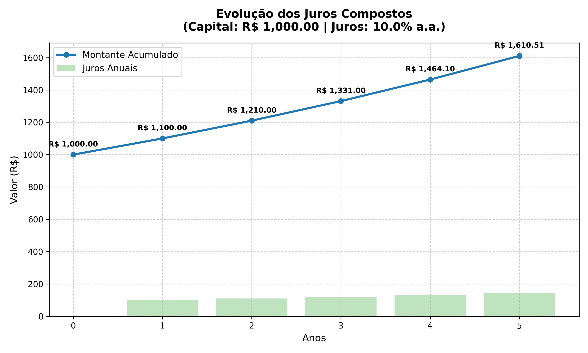

# Resumo da Implementação - Cálculo de Juros Compostos

A implementação da calculadora de juros compostos foi concluída com sucesso.

## Mudanças Realizadas

Criamos uma estrutura de pastas organizada para a tarefa sob a pasta da tarefa no workspace:
- [juros.py](file:///home/girotto/Área de Trabalho/TCC_Artefatos/tarefa_1_calculadora_juros/codigo/juros.py): O script de cálculo em Python.
- [resultado_terminal.txt](file:///home/girotto/Área de Trabalho/TCC_Artefatos/tarefa_1_calculadora_juros/prints/resultado_terminal.txt): O log textual do terminal contendo os resultados calculados.
- [evolucao_juros.png](file:///home/girotto/Área de Trabalho/TCC_Artefatos/tarefa_1_calculadora_juros/prints/evolucao_juros.png): Gráfico mostrando a evolução anual do capital acumulado e dos juros.

## Resultados e Validação

### Execução no Terminal
Os juros compostos calculados para o capital inicial de **R$ 1.000,00**, com taxa de **10% ao ano** durante **5 anos** resultaram em:
- **Total de Juros Ganhos**: R$ 610,51
- **Montante Final**: R$ 1.610,51

Saída textual formatada:
```text
============================================================
            CALCULADORA DE JUROS COMPOSTOS
============================================================
 Capital Inicial: R$ 1,000.00
 Taxa de Juros : 10.0% ao ano
 Período        : 5 anos
------------------------------------------------------------
  Ano  |  Saldo Inicial  | Juros Gerados |   Saldo Final
------------------------------------------------------------
   1   | R$    1,000.00 | R$    100.00 | R$    1,100.00
   2   | R$    1,100.00 | R$    110.00 | R$    1,210.00
   3   | R$    1,210.00 | R$    121.00 | R$    1,331.00
   4   | R$    1,331.00 | R$    133.10 | R$    1,464.10
   5   | R$    1,464.10 | R$    146.41 | R$    1,610.51
------------------------------------------------------------
 Total de Juros Ganhos: R$ 610.51
 Montante Final       : R$ 1,610.51
============================================================
```

### Gráfico Gerado
Abaixo está o gráfico gerado que ilustra o crescimento do capital e dos juros anuais:


