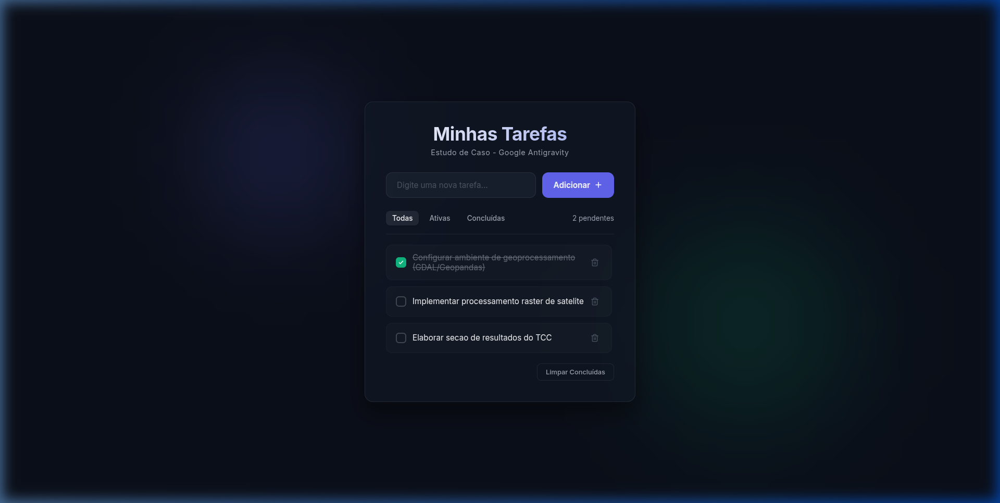

# Resumo da Implementação - Tarefa 2: To-Do List Premium e Automação de Navegador

A criação do aplicativo To-Do List e a validação automatizada no navegador interno foram concluídas com sucesso.

## Mudanças Realizadas

Desenvolvemos a To-Do list interativa estruturada em:
- [index.html](file:///home/girotto/Área de Trabalho/TCC_Artefatos/tarefa_2_todo_list/codigo/index.html): HTML semântico com fonte Inter.
- [style.css](file:///home/girotto/Área de Trabalho/TCC_Artefatos/tarefa_2_todo_list/codigo/style.css): Folha de estilo premium em Modo Escuro com Glassmorphism, gradientes e animações CSS.
- [script.js](file:///home/girotto/Área de Trabalho/TCC_Artefatos/tarefa_2_todo_list/codigo/script.js): Lógica Vanilla JS com salvamento local (`localStorage`) e filtros funcionais.

## Resultados e Validação

### Teste de Navegador
O subagente do navegador executou com sucesso o seguinte fluxo:
1. Carregou a página `http://localhost:8080` rodando no servidor local Python.
2. Adicionou 3 tarefas:
   - "Configurar ambiente de geoprocessamento (GDAL/Geopandas)"
   - "Implementar processamento raster de satelite"
   - "Elaborar secao de resultados do TCC"
3. Marcou a primeira tarefa como concluída.
4. Alternou e testou os filtros ("Ativas", "Concluídas", "Todas").

### Logs de Interações do Navegador
O log detalhado das interações do subagente e do console está documentado em [log_navegador.txt](file:///home/girotto/Área de Trabalho/TCC_Artefatos/tarefa_2_todo_list/prints/log_navegador.txt).

### Demonstração Visual

Abaixo está o estado final do aplicativo após o teste:

Abaixo está a gravação da sessão automatizada mostrando a interação do subagente:

